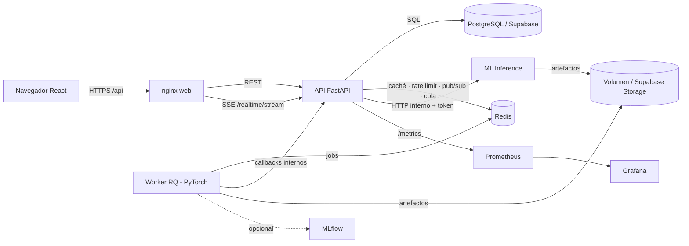

# Arquitectura

## Estilo
Monolito modular por dominios (API) + servicio de inferencia separado + worker asíncrono. Permite escalar la inferencia y el entrenamiento sin fragmentar el dominio académico en microservicios prematuros.

## Dominios de la API (`apps/api/app/modules`)
| Módulo | Responsabilidad |
|---|---|
| `identity` | Login, refresh rotatorio, logout con revocación (`token_version`), usuarios, roles, instituciones, configuración |
| `academic` | Cursos, unidades, lecciones, ofertas, matrículas, competencias, cohortes, rutas, evaluaciones, intentos y calificación |
| `tracking` | Ingesta idempotente de eventos, progreso por estudiante |
| `progress` | Recálculo transaccional del avance y agregados diarios incrementales |
| `analytics` | KPIs con fuente/fecha/variación, series, mapa por región, finalización, heatmap, exportación CSV/XLSX/PDF |
| `recommendations` | Modelo → reglas de negocio → explicación → feedback |
| `certificates` | Emisión, folio, PDF con QR, anulación, reemisión, verificación pública mínima |
| `community` | Hilos, respuestas, anuncios, reportes, moderación |
| `notifications` | Notificaciones, preferencias, feed de actividad, auditoría y verificación de cadena hash |
| `ml` | Datasets, entrenamiento asíncrono, registro, aprobación, promoción, rollback, inferencia, topología |
| `realtime` | Publicador Outbox → Redis → SSE autorizado; tickets de un solo uso; replay por `Last-Event-ID` |
| `tutor` | IA Tutor con contexto minimizado y LLM externo opcional |

## Flujo de un evento
1. El cambio de negocio y su `OutboxEvent` se escriben **en la misma transacción**.
2. `outbox_publisher` (con `FOR UPDATE SKIP LOCKED`) publica en el canal `org:<id>` de Redis.
3. Cada conexión SSE filtra por institución, rol y usuario; reenvía con `id = seq`.
4. Tras una desconexión, el navegador reconecta con backoff y pide lo pendiente desde su último `seq`.
5. El frontend invalida las consultas afectadas (TanStack Query) o alimenta el visualizador.

## Visualizador neuronal
`describe(model)` en `apps/ml/.../models/networks.py` serializa las capas reales (operación, neuronas, tensor, parámetros) y los pesos muestreados. `NeuralNetworkCanvas` dibuja en Canvas 2D aislado de React:
- Propagación hacia delante solo con **inferencia real** (activaciones reales por capa) o simulación **rotulada**.
- Retropropagación solo con **entrenamiento real**; intensidad = norma del gradiente por capa enviada en cada época.
- Partícula sináptica que viaja por la conexión y destella la neurona al llegar; intensidad = activación × |peso|.
- `prefers-reduced-motion`, pausa fuera de pantalla, 30 FPS en miniaturas.

## Decisiones
| Decisión | Motivo |
|---|---|
| SSE en vez de WebSocket | Tráfico servidor→cliente; atraviesa proxies; reconexión nativa con `Last-Event-ID` |
| RQ en vez de Celery | Menos piezas; suficiente para trabajos de entrenamiento/ETL |
| Agregado `daily_metrics` | El dashboard no recalcula sobre tablas OLTP en cada carga |
| Auditoría con hash encadenado + trigger inmutable | Evidencia de alteración |
| Servicio ML sin estado | La API decide qué versión es productiva y la pasa en cada petición |
