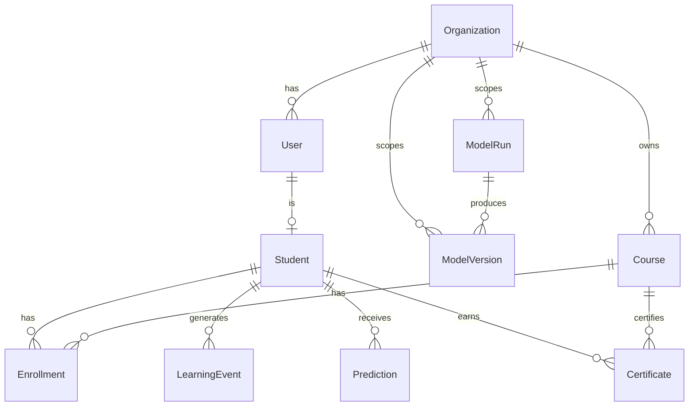

# ERD — EduMaster.ai (resumen)

## Multi-tenant
`ModelRun` y `ModelVersion` llevan `organization_id` nullable: `NULL` = artefacto de
plataforma (DEMO/bootstrap), visible para todas las instituciones; con valor = aislado
por institución. Superadmin ve todo.
